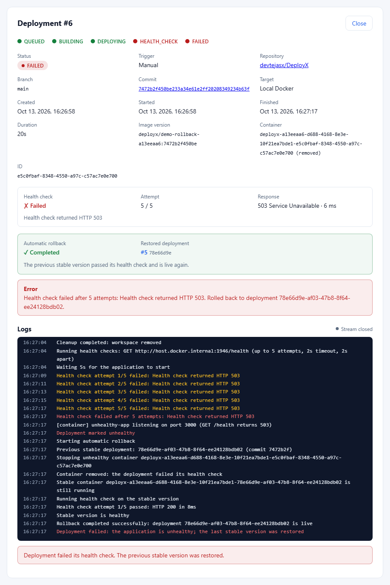
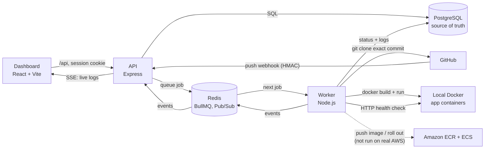
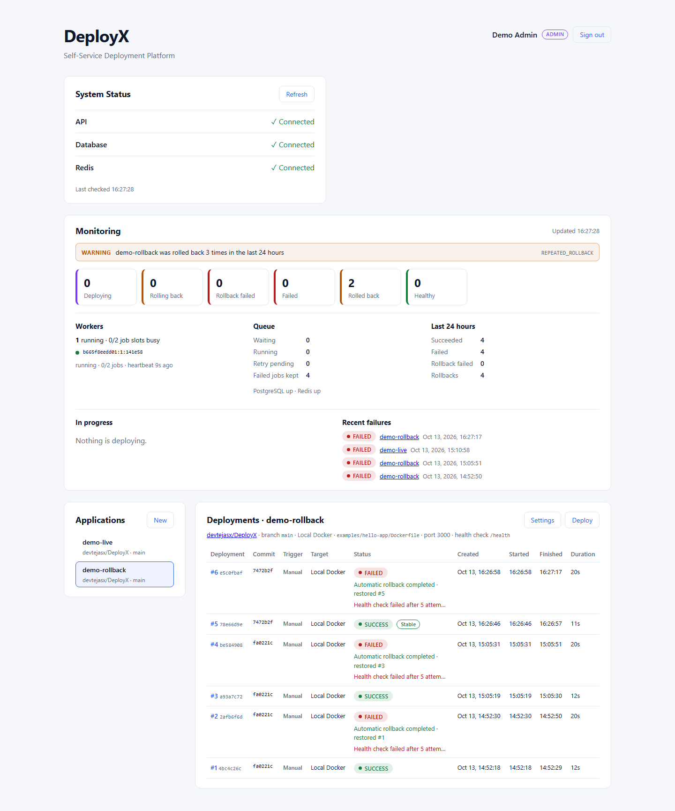
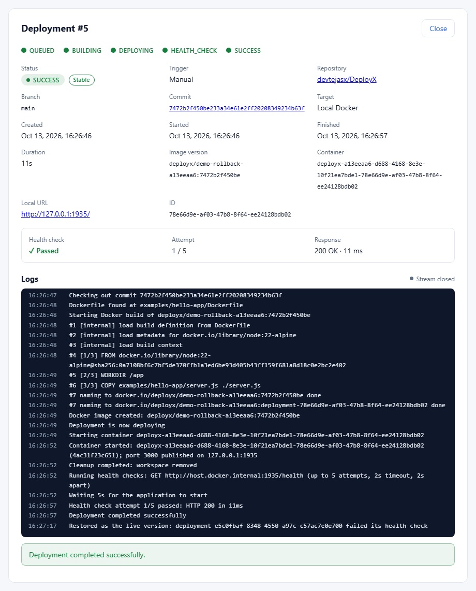

# DeployX

A self-service deployment platform: connect a GitHub repository, and every deployment is built into a Docker image from an exact commit, started, **health-checked**, and **rolled back automatically** to the last stable version if it is unhealthy, with the whole lifecycle streamed live to a dashboard.



> **Status.** Built in nine phases and validated in a real environment (real GitHub webhooks, real Docker deployments and rollbacks, injected outages, 78 live security checks, backup and restore): see the [Phase 9 validation report](docs/PHASE9_VALIDATION.md). **The AWS ECR/ECS target is implemented and tested against fake AWS endpoints, but it has not been validated against real AWS infrastructure**, so there is no `v1.0.0` release yet.

## Key capabilities

| Capability | Status |
| ---------- | ------ |
| Deploy a GitHub repository (public, or private through a GitHub App) at an exact commit | ✅ Done, validated with real GitHub |
| Build with Docker, run as an isolated, unprivileged container on the local Docker host | ✅ Done, validated |
| Deploy automatically on `git push` (HMAC-verified webhook, duplicate deliveries ignored) | ✅ Done, validated with real GitHub deliveries |
| HTTP health check after every deployment; `SUCCESS` only when healthy | ✅ Done, validated |
| Automatic rollback to the last stable version; `ROLLBACK_FAILED` when that is impossible | ✅ Done, validated |
| Deployment state machine enforced by PostgreSQL | ✅ Done |
| Live logs and status over Server-Sent Events, with reconnect and resume | ✅ Done, validated in a real browser |
| Accounts, sessions, ADMIN/USER authorization, audit log | ✅ Done, validated (78 live checks) |
| Rate limits, security headers, CORS/CSRF protection, SSRF protection | ✅ Done, validated |
| Monitoring panel, Prometheus metrics, health and readiness probes, alert rules | ✅ Done, validated |
| Recovery from worker crashes, lost jobs, PostgreSQL/Redis outages, timeouts | ✅ Done, validated by injected failures |
| Deploy to **Amazon ECS** (image pushed to **ECR**), health check and rollback by image digest | ⚠️ Implemented and tested against fakes only; **not run on real AWS** |

## Architecture



The API never does deployment work: it stores the deployment, queues a job and returns. The worker clones the commit, builds the image, starts it on its target, checks its health and either marks it `SUCCESS` (retiring the previous version) or restores the last stable version. Every status change goes through a state machine enforced by a PostgreSQL trigger, and every log line reaches the dashboard through Redis Pub/Sub and Server-Sent Events. Details: [Architecture](docs/ARCHITECTURE.md) · [Deployment lifecycle](docs/DEPLOYMENT_LIFECYCLE.md).

```text
QUEUED → BUILDING → DEPLOYING → HEALTH_CHECK → SUCCESS (stable)
                                     │
                                     └─ unhealthy → ROLLING_BACK → FAILED (previous version restored)
                                                                 └ ROLLBACK_FAILED (nothing healthy to restore)
```

## Technology stack

| Layer | Technology |
| ----- | ---------- |
| Dashboard | React 19, Vite 8, plain CSS (light and dark) |
| API | Node.js ≥ 20.12, Express 5, zod 4, Helmet, `express-rate-limit` |
| Worker | Node.js, BullMQ 6, `git`, Docker CLI (BuildKit), AWS SDK v3 (ECR, ECS) |
| Data | PostgreSQL 17 (`pg`, node-pg-migrate SQL migrations), Redis 7 (`ioredis`) |
| Observability | structured JSON logs, Prometheus metrics (`prom-client`), alert rules |
| Tests | `node:test` (API, worker, Docker end to end), Vitest + Testing Library (dashboard) |
| Local infrastructure | Docker Compose |

## Screenshots

Captured from the running application on 2026-10-13 (local Docker Compose stack, the [demo](docs/DEMO_GUIDE.md) data). More in the [demo guide](docs/DEMO_GUIDE.md#screenshots).

| Dashboard and monitoring | Healthy deployment |
| ------------------------ | ------------------ |
|  |  |

## Getting started

**Prerequisites:** Docker Desktop (or Docker Engine with Compose), Node.js 20.12+ and Git.

```bash
git clone https://github.com/devtejasx/DeployX.git
cd DeployX
cp .env.example .env              # development defaults; never commit .env
docker compose up -d --build      # PostgreSQL, Redis, migrations, API :5000, dashboard :3000, worker
```

`docker compose up` runs the database migrations (the `migrate` service) before the API starts. Then create the first administrator, either by registering in the dashboard at http://localhost:3000 (the first account while no ADMIN exists becomes ADMIN) or on the command line, with the password taken from a variable rather than an argument:

```bash
read -rs DEPLOYX_USER_PASSWORD && export DEPLOYX_USER_PASSWORD
docker compose exec -e DEPLOYX_USER_PASSWORD server npm run user:create -- --email admin@example.com --role ADMIN
```

To run the API, worker and dashboard on the host instead (with hot reload), and for every environment variable, see [Local setup](docs/LOCAL_SETUP.md):

```bash
npm run install:all && npm run infra:up && npm run migrate
npm run dev:server    # API on :5000
npm run dev:worker    # deployment worker
npm run dev:client    # dashboard on :3000
```

**Configuration** lives in `.env` ([`.env.example`](.env.example) lists every variable with its development default; [`.env.production.example`](.env.production.example) the production ones). With `NODE_ENV=production` the API refuses to start with development passwords. See [Environment variables](docs/LOCAL_SETUP.md#environment-variables) and [Production configuration](docs/OPERATIONS.md#production-configuration).

## Demo: deploy, break, roll back

This repository doubles as the test repository: [`examples/`](examples) holds small apps, including `hello-app` (healthy) and `unhealthy-app` (`GET /health` answers 503).

```bash
export DEMO_EMAIL=admin@example.com                     # the account created above
read -rs DEMO_PASSWORD && export DEMO_PASSWORD           # its password, not echoed
npm run demo
```

`npm run demo` creates an application for `examples/hello-app`, deploys it to `SUCCESS`, points it at `examples/unhealthy-app`, deploys again, checks that the health check fails five times and the rollback restores the first version, verifies that version still answers, and prints dashboard links. Run twice on 2026-10-13, it completed in 33 s each time. The [demo guide](docs/DEMO_GUIDE.md) has the recorded output and the same walkthrough in the dashboard, step by step with what to expect.

In the dashboard: **New** (under Applications) → repository `https://github.com/devtejasx/DeployX`, Dockerfile path `examples/hello-app/Dockerfile`, port `3000` → **Deploy**. To see a rollback, change the Dockerfile path to `examples/unhealthy-app/Dockerfile` in **Settings** and deploy again.

## How it works

**Local Docker deployments.** The worker clones the repository at the exact commit into a throwaway workspace, validates the Dockerfile path, builds `deployx/<project>-<id>:<commit>` and runs it on the isolated `deployx-apps` network with the port published on `127.0.0.1`, all capabilities dropped, no mounts and memory/CPU limits. Build and start-up failures are retried (3 attempts, exponential backoff); a missing repository, branch, commit or Dockerfile fails at once. → [Docker deployments](docs/DEPLOYMENT_LIFECYCLE.md#docker-deployments)

**Health checks and automatic rollback.** After the container starts, the worker requests the application's health-check path (default `/health`, 5 attempts, 2 s apart, after a 5 s grace period). Only a 2xx answer makes the deployment `SUCCESS`; the previous version keeps serving until then. An unhealthy deployment is removed and the last stable deployment is verified (or restarted from its image) and health-checked; the outcome is recorded as `COMPLETED`, `FAILED` (`ROLLBACK_FAILED`) or `NOT_AVAILABLE`. → [Health checks and automatic rollback](docs/DEPLOYMENT_LIFECYCLE.md#health-checks-and-automatic-rollback)

**GitHub webhooks.** Point a repository webhook at `https://<your-host>/api/webhooks/github` (content type `application/json`, push events, the secret in `GITHUB_WEBHOOK_SECRET`). The signature is verified in constant time before the body is read; a push to a project's branch deploys that exact commit, and a redelivered push is ignored. GitHub must reach DeployX over HTTPS, so locally you need a tunnel. Private repositories use a GitHub App with read-only access. → [GitHub integration](docs/DEPLOYMENT_LIFECYCLE.md#webhook-configuration)

**AWS ECR/ECS (not yet validated on AWS).** A project can target an existing ECS service instead of local Docker: the worker pushes the image to ECR, registers a task definition revision pinned to the image digest, updates the service, waits for the rollout, health-checks the service URL, and rolls back by redeploying the stable digest. It needs `AWS_REGION`, `AWS_ECR_REPOSITORY`, `AWS_ECS_CLUSTER`, an existing ECS service per project and an IAM role with the [least-privilege policy](docs/DEPLOYMENT_LIFECYCLE.md#aws-deployment-architecture). **This path has only run against fake ECR and ECS endpoints in the test suite; it has never been run against a real AWS account**, and that run is the remaining release gate. → [AWS deployment](docs/DEPLOYMENT_LIFECYCLE.md#aws-deployment-architecture)

**Authentication and authorization.** Email and password (scrypt), server-side sessions in an HttpOnly, SameSite=Strict cookie, no tokens in the browser. Users see only their own applications (another user's resources answer `403`); ADMINs see everything and can use operator endpoints. Security-sensitive actions go to an audit log. → [Security](docs/SECURITY.md)

**Live logs.** `GET /api/deployments/:id/logs/stream` sends the stored lines, then every new line and status change as Server-Sent Events, resumes after a disconnect with `Last-Event-ID`, and falls back to reading PostgreSQL if Redis events are lost. → [Real-time deployment logs](docs/DEPLOYMENT_LIFECYCLE.md#real-time-deployment-logs)

**Monitoring.** The dashboard's monitoring panel shows alerts, applications by state, worker heartbeats, the queue and recent failures. The API and worker expose `/health`, `/ready` and Prometheus `/metrics`; alert rules are in [`monitoring/`](monitoring). → [Operations](docs/OPERATIONS.md) · [Troubleshooting](docs/TROUBLESHOOTING.md)

## Tests

| Suite | Command | Result (2026-10-13) |
| ----- | ------- | ------------------- |
| API, worker, integration, security, reliability (needs `npm run infra:up`) | `npm test` | **382/382** passed, ~95 s |
| Dashboard (Vitest, jsdom) | `npm run test:client` | **30/30** passed, ~2 s |
| Docker end to end: real clone from GitHub, build, run, health check, rollback | `npm run test:docker` | **11/11** passed, ~2.5 min |
| Dashboard production build | `npm run build:client` | passes |

No suite needs AWS: the AWS path is tested against fake ECR and ECS endpoints. The real-environment validation (real webhooks, outages, security checks, backup and restore) is in the [Phase 9 report](docs/PHASE9_VALIDATION.md). → [Testing](docs/LOCAL_SETUP.md#testing)

## Known limitations

- **Real AWS has not been run.** ECR, ECS, the health check and rollback on AWS, and the IAM policy are verified only against fakes and by review.
- **The worker drives the host's Docker daemon** (root-equivalent on that host) and builds run with the daemon's privileges. Run untrusted code only on a dedicated build host. → [Docker security](docs/SECURITY.md#docker-security)
- **Local apps do not come back after a Docker host restart** (they run with `--restart no`); redeploy each application's stable commit.
- No build secrets or per-application environment variables; no OAuth/SSO, MFA, password reset or user-management UI; one ADMIN/USER role pair.
- The Compose file is a development stack: production needs HTTPS, private PostgreSQL/Redis, real secrets and the [production checklist](docs/OPERATIONS.md#production-checklist).

## Roadmap

1. **Run the AWS validation** (ECR push, ECS rollout, health check, rollback) against a real account, following [Repeating the validation](docs/PHASE9_VALIDATION.md#repeating-the-validation), then tag `v1.0.0`.
2. Restore local applications automatically after a Docker host restart.
3. Per-application environment variables and build secrets.
4. Stronger build isolation (rootless BuildKit or a separate build host).

## Documentation

| Document | Contents |
| -------- | -------- |
| [Local setup](docs/LOCAL_SETUP.md) | quick start, Compose services, running on the host, environment variables, tests |
| [Demo guide](docs/DEMO_GUIDE.md) | repeatable demo, expected results, screenshots |
| [Architecture](docs/ARCHITECTURE.md) | components, data model, job queue, dashboard, repository layout |
| [Deployment lifecycle](docs/DEPLOYMENT_LIFECYCLE.md) | Docker pipeline, state machine, live logs, health checks, rollback, GitHub, AWS |
| [Security](docs/SECURITY.md) | authentication, authorization, hardening, secrets, SSRF, audit log |
| [Operations](docs/OPERATIONS.md) | reliability, logs, metrics, monitoring, alerting, backups, production checklist |
| [API reference](docs/API.md) | endpoints, request and response formats, calling the API with curl |
| [Troubleshooting](docs/TROUBLESHOOTING.md) | common problems and fixes |
| [Phase 9 validation report](docs/PHASE9_VALIDATION.md) | real-environment validation evidence |
| [Development history](docs/PHASES.md) | what each of the nine phases added |
