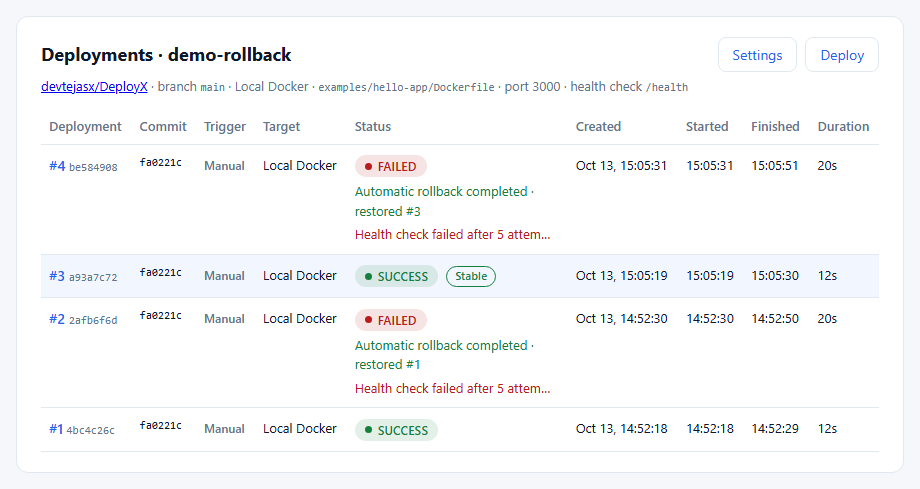
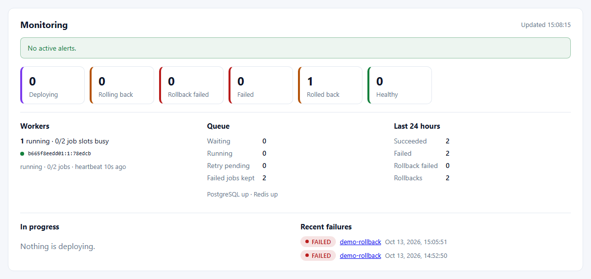
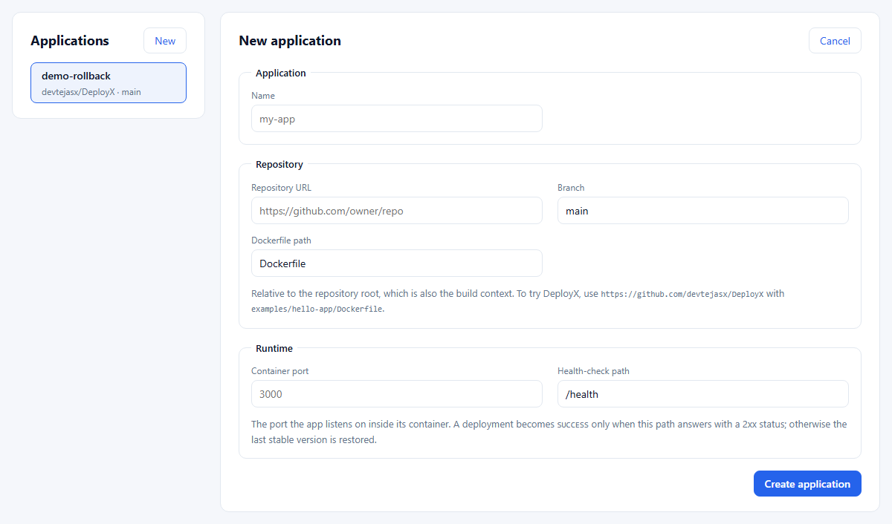
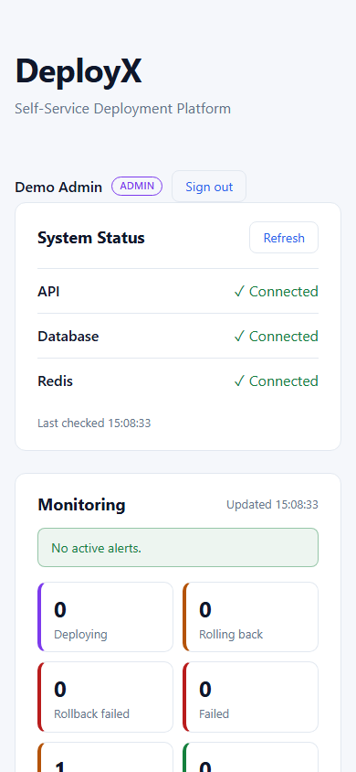

# Demo guide

A repeatable, local demonstration of DeployX's main promise: **a bad release never replaces a good one**. In about ten minutes you deploy a healthy app, deploy a broken version of it, and watch DeployX detect the failed health check and restore the previous version automatically, live in the dashboard.

Everything runs on your machine against this repository's [example apps](../examples): no GitHub webhook, no tunnel, no cloud account. The demo creates one application, `demo-rollback`, owned by the account you sign in with. It does not touch other applications, and the steps to remove it are [at the end](#cleaning-up).

**Status of this guide:** the automated demo (`npm run demo`) was **executed twice on 2026-10-13** against the Docker Compose stack, on Windows 11 with Docker Desktop 29.8, and passed both times. The output below is from the second run. The [dashboard walkthrough](#3-the-same-walkthrough-in-the-dashboard) was then performed in a browser on the same stack (application `demo-live`): the healthy deployment reached `SUCCESS` in 12 s, the unhealthy one showed `ROLLING_BACK` and ended `FAILED` with the rollback completed 21 s after **Deploy**, and the first version kept answering. The [screenshots](#screenshots) were captured from the demo data.

## 1. Start the stack and create an account

```bash
docker compose up -d --build
docker compose ps        # postgres, redis, server, worker healthy; client up; migrate exited 0
```

Create an administrator, either in the dashboard at http://localhost:3000 (**Create an account**: the first account while no ADMIN exists becomes ADMIN) or on the command line:

```bash
read -rs DEPLOYX_USER_PASSWORD && export DEPLOYX_USER_PASSWORD     # 12+ characters, not echoed
docker compose exec -e DEPLOYX_USER_PASSWORD server npm run user:create -- --email demo@deployx.local --name "Demo" --role ADMIN
```

**Expect:** `[user:create] Created demo@deployx.local (ADMIN, id …)`. Signing in at http://localhost:3000 shows System Status (API, Database, Redis: Connected), the Monitoring panel with one running worker, and an empty Applications list offering **Create your first application**.

## 2. Run the automated demo

```bash
export DEMO_EMAIL=demo@deployx.local
export DEMO_PASSWORD="$DEPLOYX_USER_PASSWORD"      # or: read -rs DEMO_PASSWORD && export DEMO_PASSWORD
npm run demo
```

[`scripts/demo.mjs`](../scripts/demo.mjs) uses only the public API: it signs in, creates (or reuses) `demo-rollback`, deploys `examples/hello-app`, switches the application to `examples/unhealthy-app` (which answers `GET /health` with 503) and deploys again, then checks every outcome and exits with code 1 if anything differs. It leaves the application pointing at `hello-app` again, so it can be run any number of times. Optional settings: `DEPLOYX_API_URL` (default `http://localhost:5000`), `DEPLOYX_DASHBOARD_URL`, `DEMO_PROJECT`, `DEMO_REPOSITORY`, `DEMO_BRANCH`, `DEMO_APP_HOST`, `DEMO_TIMEOUT_MS`.

Recorded output of the second run (container names shortened with `…`):

```text
== 1. Sign in and prepare the demo application
   0.5s  signed in as demo@deployx.local (ADMIN)
   0.5s  reusing application "demo-rollback" (a13eeaa6-d688-4168-8e3e-10f21ea7bde1)

== 2. Deploy a healthy version (examples/hello-app)
   0.5s  queued deployment a93a7c72-0694-4129-9be6-0d077780f817
   0.5s  status QUEUED
   1.1s  status BUILDING
   1.1s    log: Cloning repository https://github.com/devtejasx/DeployX (branch main)
   3.2s    log: Starting Docker build of deployx/demo-rollback-a13eeaa6:fa0221c1c14c
   3.7s  status DEPLOYING
   3.7s    log: Docker image created: deployx/demo-rollback-a13eeaa6:fa0221c1c14c
   4.2s    log: Starting container deployx-a13eeaa6-…-a93a7c72-…
   7.4s  status HEALTH_CHECK
   7.4s    log: Container started: deployx-a13eeaa6-…-a93a7c72-… (0e6b16f427ed); port 3000 published on 127.0.0.1:3424
   7.4s    log: Running health checks: GET http://host.docker.internal:3424/health (up to 5 attempts, 2s timeout, 2s apart)
  12.6s  status SUCCESS
  12.6s    log: Health check attempt 1/5 passed: HTTP 200 in 13ms
  12.7s  http://127.0.0.1:3424/health -> HTTP 200; GET / -> "Hello from DeployX"

== 3. Deploy an unhealthy version (examples/unhealthy-app: GET /health -> 503)
  12.7s  queued deployment be584908-0927-44d2-b3de-98bf1ac73561
  12.7s  status QUEUED
  13.2s  status BUILDING
  15.8s  status DEPLOYING
  19.5s  status HEALTH_CHECK
  19.5s    log: Running health checks: GET http://host.docker.internal:3896/health (up to 5 attempts, 2s timeout, 2s apart)
  24.2s    log: Health check attempt 1/5 failed: Health check returned HTTP 503
  26.3s    log: Health check attempt 2/5 failed: Health check returned HTTP 503
  28.4s    log: Health check attempt 3/5 failed: Health check returned HTTP 503
  30.5s    log: Health check attempt 4/5 failed: Health check returned HTTP 503
  32.6s  status FAILED
  32.6s    log: Health check attempt 5/5 failed: Health check returned HTTP 503
  32.6s    log: Health check failed after 5 attempts: Health check returned HTTP 503
  32.6s    log: Starting automatic rollback
  32.6s    log: Previous stable deployment: a93a7c72-0694-4129-9be6-0d077780f817 (commit fa0221c)
  32.6s    log: Stopping unhealthy container deployx-a13eeaa6-…-be584908-…
  32.6s    log: Container removed: the deployment failed its health check
  32.6s    log: Stable container deployx-a13eeaa6-…-a93a7c72-… is still running
  32.6s    log: Running health check on the stable version
  32.6s    log: Health check attempt 1/5 passed: HTTP 200 in 4ms
  32.6s    log: Stable version is healthy
  32.6s    log: Rollback completed successfully: deployment a93a7c72-0694-4129-9be6-0d077780f817 is live
  32.6s    log: Deployment failed: the application is unhealthy; the last stable version was restored
  32.6s  rollback COMPLETED: restored deployment a93a7c72-0694-4129-9be6-0d077780f817

== 4. The stable version is still live
  32.6s  http://127.0.0.1:3424/health -> HTTP 200; GET / -> "Hello from DeployX"
  32.6s  application "demo-rollback" points at examples/hello-app/Dockerfile again

== 5. History and monitoring
  #4  FAILED   · rollback COMPLETED  be584908-0927-44d2-b3de-98bf1ac73561
  #3  SUCCESS  · stable  a93a7c72-0694-4129-9be6-0d077780f817
  #2  FAILED   · rollback COMPLETED  2afb6f6d-c3fd-43b5-a18d-7ddb2d78a278
  #1  SUCCESS   4bc4c26c-dcc4-4563-87c8-377347e0c4f3
  monitoring: 1 worker(s), queue waiting 0, last 24 h 2 succeeded / 2 failed, 2 rollback(s), 0 alert(s)

Demo completed in 32.6s. Open the dashboard:
  http://localhost:3000/#/projects/a13eeaa6-…/deployments/a93a7c72-…    (healthy, stable)
  http://localhost:3000/#/projects/a13eeaa6-…/deployments/be584908-…    (failed health check, rolled back)
```

The rollback itself takes well under a second because the stable container never stopped: DeployX retires the old version only after the new one is healthy, so the "rollback" verifies the old version and removes the new one. Rows #1 and #2 are from the first run; each run adds two deployments, and only the newest healthy one is **Stable**. The script polls every 500 ms, so a `ROLLING_BACK` status that lasts less than that does not appear in its status lines, but it does in the dashboard and in the log lines above.

## 3. The same walkthrough in the dashboard

Use this to present the demo live. Each step says what to do and what you should see.

| # | Do | Expect |
| - | -- | ------ |
| 1 | Sign in at http://localhost:3000 | System Status all **Connected**; Monitoring shows **1 running** worker and **No active alerts** |
| 2 | **New** under Applications. Name `demo-live`, repository `https://github.com/devtejasx/DeployX`, branch `main`, Dockerfile path `examples/hello-app/Dockerfile`, container port `3000`, health-check path `/health`. **Create application** | The application opens with *No deployments yet*. A wrong value (for example Dockerfile path `../Dockerfile`) shows the API's message under the form instead |
| 3 | **Deploy** | Deployment **#1** opens. The steps light up `QUEUED → BUILDING → DEPLOYING → HEALTH_CHECK → SUCCESS` in about 12 s; the log viewer shows **Live** and the clone, build, container and health-check lines as they happen |
| 4 | Look at the details of #1 | **SUCCESS** with a **Stable** tag, Health check **✓ Passed** `1 / 5` `200 OK`, and a **Local URL** that answers *Hello from DeployX* |
| 5 | **Settings** → Dockerfile path `examples/unhealthy-app/Dockerfile` → **Save**, then **Deploy** | Deployment **#2** reaches `HEALTH_CHECK`; the Health check box counts failed attempts (`503 Service Unavailable`) and the activity line shows each one |
| 6 | Wait about 20 s | After attempt 5/5: **ROLLING_BACK** (↻) briefly, then **FAILED** with **Automatic rollback ✓ Completed**, *Restored deployment #1*, and the log ends with *Rollback completed successfully* |
| 7 | Open the Local URL of #1 again (or click *#1* in the rollback box) | #1 is still **Stable** and still answers *Hello from DeployX*: the broken version never replaced it |
| 8 | Scroll up to Monitoring and the history | History: #2 *Automatic rollback completed · restored #1*, #1 **Stable**. Monitoring: Last 24 hours counts the success, the failure and the rollback; *Recent failures* links to #2 |

Set the Dockerfile path back to `examples/hello-app/Dockerfile` afterwards if you want the next **Deploy** to succeed.

**Talking points.** The API only records and queues; the worker does the work. Every status change goes through a state machine enforced by a PostgreSQL trigger, so `SUCCESS` is impossible without a passed health check. Logs reach the browser over Server-Sent Events through Redis Pub/Sub and survive a reconnect. The [Phase 9 report](PHASE9_VALIDATION.md) shows the same flow driven by real GitHub pushes and under injected outages. The AWS ECS target follows the same pipeline but has only been tested against fakes.

## Screenshots

Genuine screenshots of the running dashboard, captured on 2026-10-13 from the stack and data of the demo run above (headless Chrome, 1440 px wide, light theme; the phone view at 390 px). None are mock-ups.

| Screenshot | Shows |
| ---------- | ----- |
|  | [`dashboard.png`](screenshots/dashboard.png): the whole page: system status, monitoring, applications and the deployment history after two demo runs |
|  | [`deployment-history.png`](screenshots/deployment-history.png): history with trigger, target, status, the **Stable** tag and the rollback outcome of each failed deployment |
|  | [`deployment-success.png`](screenshots/deployment-success.png): a healthy deployment: lifecycle steps, image and container, the passed health check and its logs |
|  | [`deployment-rollback.png`](screenshots/deployment-rollback.png): the unhealthy deployment: five failed health checks, the completed automatic rollback and the full log |
|  | [`monitoring.png`](screenshots/monitoring.png): the monitoring panel: alerts, applications by state, worker heartbeat, queue, last 24 hours, recent failures |
|  | [`new-application.png`](screenshots/new-application.png): the form that creates an application |
|  | [`mobile.png`](screenshots/mobile.png): the top of the dashboard at phone width |

Not captured: the sign-in form and a live, in-progress deployment (both are easy to see by following the walkthrough). To capture fresh screenshots, run the demo, open the dashboard links it prints, and take them at the same sizes.

## Cleaning up

The demo data lives in your local development database. To remove the demo application and its containers and images:

```bash
# in the dashboard there is no delete button; with the API (see API.md for signing in with curl):
curl -X DELETE -b cookies.txt http://localhost:5000/api/projects/<projectId>
# the API deliberately has no Docker access, so remove the app containers and images yourself:
docker rm -f $(docker ps -aq --filter label=deployx.project=<projectId>)
docker image rm $(docker image ls -q "deployx/demo-rollback-*")
```

`docker compose down -v` removes everything instead, including all DeployX data.
